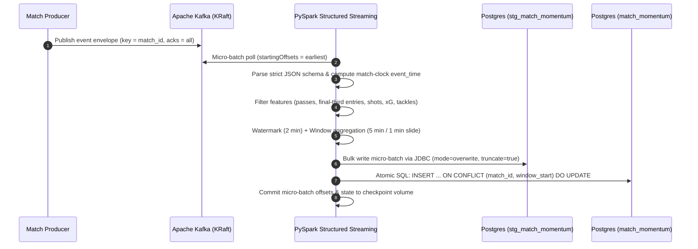

# ⚽ Live Momentum Engine

[](https://github.com/rahulamatapu/soccer-analytics/actions/workflows/ci.yml)


-231F20?logo=apachekafka&logoColor=white)


A production-grade, real-time streaming data pipeline that ingests live soccer match events, calculates rolling momentum metrics using stateful stream processing, and continuously sinks deduplicated, windowed analytics into PostgreSQL.


---

## 📌 Table of Contents
- [Project Overview & Value Proposition](#-project-overview--value-proposition)
- [System Architecture](#-system-architecture)
- [Momentum Metric Formulation](#-momentum-metric-formulation)
- [Key Engineering Principles](#-key-engineering-principles)
  - [1. Match-Clock Determinism](#1-match-clock-determinism-vs-wall-clock)
  - [2. Stateful Sliding Windows & Watermarking](#2-stateful-sliding-windows--watermarking)
  - [3. Replay Idempotency & Fault Tolerance](#3-replay-idempotency--fault-tolerance)
- [Tech Stack](#-tech-stack)
- [Quickstart Guide](#-quickstart-guide)
- [Querying Real-Time Metrics](#-querying-real-time-metrics)
- [Testing & Quality Assurance](#-testing--quality-assurance)
- [Repository Structure](#-repository-structure)

---

## 🎯 Project Overview & Value Proposition

Traditional soccer analytics operates in **batch mode**: after the final whistle, match logs are processed overnight for post-match reports. In contrast, modern sports analytics, in-play betting models, and live broadcast graphics require **continuous, sub-minute insights** as gameplay unfolds.

This project demonstrates the transition from batch to stream processing by solving core distributed streaming challenges:
* **Continuous Ingestion:** Replaying high-resolution event data with realistic live pacing and simulated out-of-order jitter.
* **Stateful Aggregations:** Maintaining 5-minute rolling windows updating every 1 minute with conditional single-pass home/away pivots.
* **Late Data Handling:** Implementing event-time watermarking to accommodate sensor delays without breaking window state.
* **Idempotent Storage:** Guaranteeing exact-once relational state upon stream replays using staging tables and atomic SQL `ON CONFLICT` upserts.
* **Reproducible Infrastructure:** Entire architecture spins up via a single Docker Compose deployment with baked-in connectors.

---

## 🏗 System Architecture

```mermaid
flowchart LR
    subgraph Ingestion["Ingestion Layer"]
        SB["StatsBomb Open Data\n(4,407 Events)"]
        PROD["Python Producer\n(pacing + late jitter)"]
        SB --> PROD
    end

    subgraph Messaging["Message Broker"]
        KAFKA[("Apache Kafka\n(KRaft Mode)\ntopic: live-match-events\nkey: match_id")]
        PROD -- "JSON Envelope\nacks=all" --> KAFKA
    end

    subgraph Processing["Processing Engine (PySpark 3.5)"]
        STREAM["Kafka Structured Streaming\n(micro-batches)"]
        PARSE["JSON Deserializer\n& Schema Enforcer"]
        TIME["Match-Clock\nEvent Time Derivation"]
        FEAT["Momentum Feature Extraction\n(X >= 80, Shots, xG, Duels)"]
        AGG["5-Min Sliding Window Aggregation\n(1-Min Slide, 2-Min Watermark)"]
        
        KAFKA --> STREAM
        STREAM --> PARSE --> TIME --> FEAT --> AGG
    end

    subgraph Storage["Storage Layer (PostgreSQL 16)"]
        STG[("stg_match_momentum\n(UNLOGGED staging)")]
        PROD_DB[("match_momentum\n(PK: match_id, window_start)")]
        VIEW["v_latest_momentum\n(Analytical View)"]
        
        AGG -- "foreachBatch JDBC" --> STG
        STG -- "Atomic INSERT ON CONFLICT DO UPDATE" --> PROD_DB
        PROD_DB --> VIEW
    end

    subgraph StateMgmt["State Management"]
        CKPT[("Volume:\nspark-checkpoints")]
        AGG -. "Offsets & State" .-> CKPT
    end
```



### End-to-End Pipeline Sequence



---

## 📐 Momentum Metric Formulation

Possession percentage alone is often misleading: a team passing sideways between center-backs in their own half controls possession without generating attacking threat.

To quantify **true territorial and attacking dominance**, our engine computes a composite **Momentum Score** over each rolling 5-minute window:

$$\text{Momentum Score} = (1.0 \times \text{Final-Third Passes}) + (3.0 \times \text{Shots}) + (5.0 \times \text{Total xG}) + (0.5 \times \text{Tackles})$$

$$\text{Momentum Difference} = \text{Home Momentum} - \text{Away Momentum}$$

* **Final-Third Passes ($1.0\times$):** Completed passes ending at $X \ge 80.0$ on StatsBomb's $120 \times 80$ meter pitch coordinate system.
* **Shots ($3.0\times$) & Expected Goals ($5.0\times$):** High-leverage goal-scoring opportunities weighted heavily by statistical shot quality.
* **Defensive Tackles ($0.5\times$):** Ground duels classified as tackles, capturing active defensive pressing and ball recovery.
* **Interpretation:**
  * Positive $\Delta$ ($\text{e.g. } +15.5$): Home team (Argentina) is in an aggressive, attacking surge.
  * Negative $\Delta$ ($\text{e.g. } -10.2$): Away team (France) is dominating territorial pressure.

---

## ⚙️ Key Engineering Principles

### 1. Match-Clock Determinism vs. Wall-Clock
StatsBomb match timestamps restart at `00:00:00.000` at the beginning of each period (1st half, 2nd half, extra time). If a pipeline relied on producer wall-clock arrival times, replaying a match at $1\times$, $30\times$, or $0\times$ speed would result in completely different window keys.

Instead, the engine derives a continuous **match-clock timestamp**:

$$\text{Event Time} = \text{Kickoff Timestamp} + \text{Period Offset} + \text{Time in Period}$$

$$\text{Period Offsets} = \{1: 0', \; 2: 60', \; 3: 120', \; 4: 150', \; 5: 180'\}$$

where `event_time` is continuous match time, and `PERIOD_OFFSETS` maps period start offsets in seconds:
`{1: 0, 2: 3600, 3: 7200, 4: 9000, 5: 10800}`.

* **Stoppage-time safety:** A 15-minute gap between periods ensures that extended first-half stoppage time (e.g. minute 52) never collides with the start of the second half.
* **Determinism:** Every replay of a historic match produces the exact same timestamps and window boundaries.

### 2. Stateful Sliding Windows & Watermarking
To evaluate recent form, the engine evaluates a **5-minute sliding window that recalculates every 1 minute**:
- Window 1: `17:00:00` to `17:05:00`
- Window 2: `17:01:00` to `17:06:00`
- Window 3: `17:02:00` to `17:07:00`

```
Time:      17:00       17:01       17:02       17:05       17:06       17:07
Window 1:  [===================================]
Window 2:              [===================================]
Window 3:                          [===================================]
```

* **Late Data Grace Period (Watermark):** Network lag and stadium sensors can cause out-of-order events. With `.withWatermark("event_time", "2 minutes")`, Spark retains active window state in memory. If an event from minute `17:03` arrives at `17:04:30`, the window is updated. If an event arrives later than 2 minutes past the current event-time watermark, it is safely dropped, preventing unbounded memory growth.

### 3. Replay Idempotency & Fault Tolerance
Distributed stream processing operates on **at-least-once delivery semantics**. If a worker or job crashes and restarts, micro-batches may be re-executed:
1. **Natural Primary Key:** The target table defines `PRIMARY KEY (match_id, window_start)`.
2. **Two-Tier Upsert:**
   - Spark micro-batches bulk-insert into an unlogged staging table (`stg_match_momentum`) via high-speed JDBC (`mode="overwrite", truncate="true"`).
   - An atomic PostgreSQL transaction executes `INSERT INTO match_momentum ... ON CONFLICT (match_id, window_start) DO UPDATE SET ...`.
3. **Idempotency Guarantee:** Replaying the entire match 10 times results in **0 duplicate rows** and identical metric values.
4. **State Checkpointing:** Spark streaming offsets and state stores are committed to the named volume `spark-checkpoints:/checkpoints/dev/momentum`. If restarted, Spark resumes seamlessly from the exact Kafka offset it last committed.

---

## 💻 Tech Stack

| Layer | Technology | Purpose |
|---|---|---|
| **Data Source** | `statsbombpy` (open data) | Granular spatial-temporal match events (2022 World Cup Final: Argentina vs France) |
| **Message Broker** | Apache Kafka 3.8.0 | Single-node KRaft mode; partitioned event streaming keyed by `match_id` |
| **Processing Engine** | Apache Spark 3.5.3 (PySpark) | Structured Streaming, match-clock derivation, 5-min sliding windows, watermarking |
| **Database Sink** | PostgreSQL 16 | Relational store with composite PKs, staging tables, and real-time analytical views |
| **Connectors** | `spark-sql-kafka-0-10`, `postgresql-42.7.4` | Baked directly into the container image to eliminate runtime Ivy downloads |
| **Infrastructure** | Docker Compose v2 | Containerized local orchestration (Kafka, Postgres, Spark, Producer) |
| **Tooling** | `uv`, `ruff`, `pytest`, GitHub Actions | Deterministic package management, linting, automated CI testing suite |

---

## 🚀 Quickstart Guide

### Prerequisites
- [Docker Desktop](https://www.docker.com/products/docker-desktop/) (running)
- (Optional) [uv](https://docs.astral.sh/uv/) if running tests or producers directly on your Mac.

### 1. Clone & Setup Environment
```bash
git clone https://github.com/rahulamatapu/soccer-analytics.git
cd soccer-analytics
cp .env.example .env
```

### 2. Start Core Infrastructure (Kafka + PostgreSQL)
```bash
make up
```
*Spins up Kafka (KRaft), creates the `live-match-events` topic with 3 partitions, and boots PostgreSQL with database schemas.*

### 3. Start PySpark Streaming Processor
```bash
make spark-run
```
*Spins up the Spark Structured Streaming container and begins consuming micro-batches from Kafka.*

### 4. Replay Match Events (Simulate Live Stream)
In a second terminal, replay the 2022 World Cup Final:
```bash
# Option A: Run via containerized producer (no local Python required)
make produce ARGS="--speed 30"

# Option B: Run locally on your Mac via uv (at 30x live speed, finishes in ~3-4 mins)
make produce-local ARGS="--speed 30"

# Option C: Instant replay (speed 0, dumps events immediately)
make produce-local ARGS="--speed 0 --max-events 500"
```

---

## 📊 Querying Real-Time Metrics

While events are streaming, query the live momentum metrics directly from PostgreSQL:

```bash
# 1. Inspect the single latest rolling momentum score
make query-latest

# 2. Inspect the 10 most recent rolling momentum windows
make query-momentum

# 3. Open an interactive psql shell
make psql
```

### Example SQL Queries

#### Latest Match State
```sql
SELECT 
    home_team, 
    away_team, 
    home_possession_pct, 
    away_possession_pct, 
    home_momentum, 
    away_momentum, 
    momentum_diff,
    updated_at
FROM v_latest_momentum;
```

#### Momentum Progression Timeline
```sql
SELECT 
    window_start, 
    home_possession_pct AS arg_poss, 
    away_possession_pct AS fra_poss, 
    home_shots AS arg_shots, 
    away_shots AS fra_shots, 
    home_total_xg AS arg_xg, 
    home_momentum AS arg_momentum, 
    away_momentum AS fra_momentum, 
    momentum_diff
FROM match_momentum
ORDER BY window_start ASC;
```

---

## 🧪 Testing & Quality Assurance

The project includes a comprehensive 26-test suite covering config parsing, producer delay mechanics, schema deserialization, match clock offsets, feature extraction, sliding window arithmetic, and JDBC upserts.

```bash
# Run unit test suite inside the containerized Spark environment
make spark-test

# Run unit tests locally via uv
uv run pytest -v

# Run code formatting and lint checks
uv run ruff check . && uv run ruff format --check .
```

### Automated CI Pipeline
On every push and pull request to `main`, GitHub Actions automatically:
1. Sets up Java 17 and Python 3.11 with `uv`.
2. Validates lockfile integrity and installs dependencies.
3. Executes Ruff linting and formatting audits.
4. Runs the complete test suite with code coverage reports.
5. Validates the Docker Compose specification and builds container images.

---

## 📁 Repository Structure

```
soccer-analytics/
├── .github/
│   └── workflows/
│       └── ci.yml                 # GitHub Actions continuous integration pipeline
├── docs/
│   └── EXPLAINER.md               # Beginner-friendly project walkthrough with analogies
├── postgres/
│   └── init/
│       └── 001_schema.sql         # PostgreSQL schema (match_momentum, stg, views)
├── producer/
│   ├── Dockerfile                 # Containerized match event producer
│   ├── __init__.py
│   └── producer.py                # Replays StatsBomb match with simulated delays & jitter
├── spark/
│   ├── Dockerfile                 # Containerized Spark 3.5 runtime with pre-bundled JARs
│   ├── jobs/
│   │   └── momentum_stream.py     # Main PySpark Structured Streaming entrypoint
│   └── momentum/
│       ├── __init__.py
│       ├── config.py              # Strongly-typed environment configuration
│       ├── schema.py              # Strict PySpark StructType schemas
│       ├── sink.py                # foreachBatch JDBC staging + PostgreSQL upsert sink
│       └── transforms.py          # Pure DataFrame transformation functions
├── tests/
│   ├── conftest.py                # Shared local SparkSession test fixture
│   ├── test_config.py             # Configuration and environment isolation tests
│   ├── test_producer.py           # Producer pacing and late event simulation tests
│   ├── test_sink.py               # JDBC staging and transactional upsert tests
│   └── test_transforms.py         # Schema parsing, event time, and momentum logic tests
├── .env.example                   # Baseline environment variables template
├── .gitignore
├── .pre-commit-config.yaml        # Pre-commit hook definitions
├── .python-version                # Pinned to Python 3.11
├── docker-compose.yml             # Local service orchestration (Kafka, Postgres, Spark, Producer)
├── Makefile                       # Developer CLI shortcuts
├── pyproject.toml                 # uv project configuration and dependency groups
├── uv.lock                        # Pinned lockfile for reproducible environments
└── README.md
```

---

## 🛠 Makefile Cheatsheet

| Target | Description |
|---|---|
| `make up` | Start Kafka (KRaft), PostgreSQL, and initialize the event topic |
| `make down` | Stop running containers (preserves volume data) |
| `make reset` | Stop containers and **delete all data volumes** (fresh start) |
| `make build` | Build all container images (`momentum-spark`, `momentum-producer`) |
| `make produce` | Replay match events using the containerized producer |
| `make produce-local` | Replay match events using Python on your host Mac |
| `make spark-run` | Start the Spark Structured Streaming engine |
| `make spark-logs` | Follow real-time Spark container logs |
| `make spark-test` | Run the complete unit test suite inside the Spark container |
| `make query-latest` | Query the real-time latest window from `v_latest_momentum` |
| `make query-momentum` | Query the 10 most recent rolling momentum windows |
| `make psql` | Open an interactive psql shell in PostgreSQL |
| `make lint` | Run Ruff linting and format checking |
| `make test` | Run test suite locally using host virtual environment |

---

## 📜 License
This project is open-source under the MIT License. Match data provided courtesy of [StatsBomb Open Data](https://github.com/statsbomb/open-data).
